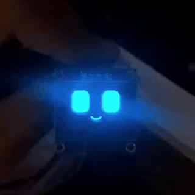
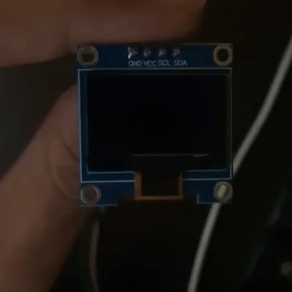

# Zin Robo Buddy 🤖

> A tiny open-source robot buddy small enough to clip on a keychain and sit on your desk.




## Overview

**Zin Robo Buddy** is a compact desktop and keychain companion robot built around the **ESP32-C3 Super Mini** and a **0.96" SSD1306 OLED display**. The goal is a pocket-sized "buddy" with an expressive animated face that is cheap, easy to build, and fully open source.

I'm building this as a B.Tech CSE (Robotics & AI) student. My earlier projects were all Arduino Uno based, so this is also my first project on the ESP32 platform. Everything I learn along the way, including mistakes, is documented here.

## Project Status

- [x] Source components
- [x] Flash and verify ESP32-C3 Super Mini
- [x] Wire and verify OLED over I2C
- [x] Animated face: idle expression (blinking and glancing)
- [ ] More expressions (happy, sleepy, surprised, and others)
- [ ] Power system (battery + charging)
- [ ] Sensors and interaction (touch / motion)
- [ ] Enclosure design (keychain + desk stand)
- [ ] Wi-Fi / Bluetooth features

## Expressions

| Expression | Status | Preview |
|---|---|---|
| Idle (blinking, glancing) | ✅ Done |  |
| Happy | Planned | - |
| Sleepy | Planned | - |
| Surprised | Planned | - |

## Hardware

| Component | Qty | Notes |
|---|---|---|
| ESP32-C3 Super Mini | 1 | Main microcontroller, native USB |
| 0.96" OLED, SSD1306, I2C (4-pin) | 1 | 128x64, address `0x3C` (some modules use `0x3D`) |
| 3.7 V, 300 mAh Li-ion/LiPo battery | 1 | Planned power source |
| USB Type-C Li-ion charging module | 1 | Planned charging; use one with cell protection |
| General-purpose PCB (perfboard) | 1 | For mounting and wiring |

> **Sourcing note:** No single shop had every part, so I sourced them from a mix of places. See [`docs/BOM.md`](docs/BOM.md) for the full parts list.

## Wiring

| OLED Pin | ESP32-C3 Super Mini |
|---|---|
| VCC | 3V3 |
| GND | GND |
| SDA | GPIO 8 |
| SCL | GPIO 9 |

> **Note:** On my display module the pin order is **GND, VCC, SCL, SDA**. Check the labels on your own board, as the order varies between vendors.
>
> Adjust the pin numbers in the sketches if you wire it differently.

## Getting Started

### 1. Software setup
1. Install the [Arduino IDE](https://www.arduino.cc/en/software).
2. Add ESP32 board support (Boards Manager, search for **esp32** by Espressif Systems).
3. Install these libraries from the Library Manager:
   - **Adafruit SSD1306**
   - **Adafruit GFX Library**
4. Select the board **ESP32C3 Dev Module** and set **USB CDC On Boot** to **Enabled**.

### 2. Put the board in bootloader mode (first upload)
A brand-new ESP32-C3 Super Mini may not show a stable COM port until it is in bootloader mode:

1. Hold the **BOOT** button.
2. While holding it, press and release **RESET** (or plug in the USB cable).
3. Release **BOOT**.
4. Select the new port in the IDE and upload.

### 3. Run the tests
| Sketch | What it does |
|---|---|
| [`firmware/00_i2c_scanner`](firmware/00_i2c_scanner/00_i2c_scanner.ino) | Lists I2C device addresses on the bus |
| [`firmware/01_oled_hello_test`](firmware/01_oled_hello_test/01_oled_hello_test.ino) | Shows "Hello!" and blinks the display on/off |
| [`firmware/02_animated_eyes`](firmware/02_animated_eyes/02_animated_eyes.ino) | Animated face, expression 1: idle with blinking and glancing |

**Expected result (Hello test):** "Hello!" appears on the screen and the display blinks every 500 ms.



**Expected result (animated eyes):** two eyes and a smile appear, blinking and glancing at random intervals.

## Troubleshooting & Lessons Learned

### The COM port keeps blinking / disappearing in the IDE
**Cause:** The board was not in bootloader mode and native USB was re-enumerating.
**Fix:** Use the BOOT + RESET sequence above, then upload.

### OLED not detected
- Run the I2C scanner and check which address is reported.
- Switch `OLED_ADDR` between `0x3C` and `0x3D`.
- Double-check SDA/SCL are not swapped and that the display is powered from 3V3.

### The "blinking Hello" animation froze when I disconnected the board
This surprised me at first, so here is what is actually happening.

The SSD1306 has its **own built-in display memory (GDDRAM)** and its own driver. The ESP32 only sends it data and commands over I2C (SDA carries data, SCL carries the clock). The display does not need a continuous stream from the microcontroller to keep showing an image. It keeps drawing whatever is stored in its memory.

So when the ESP32 stopped (unplugged or lost power) while the display still had power, no new commands (like "display off") arrived, and the screen simply **kept showing the last state it was given**. The animation looked frozen because the thing driving it was gone, not because the display was replaying a clock signal.

**Takeaway:** I2C is master-driven. The ESP32 controls the timing, and the OLED just holds the last frame until it receives a new one or loses power.

## Repository Structure

```
.
├── firmware/
│   ├── 00_i2c_scanner/
│   ├── 01_oled_hello_test/
│   └── 02_animated_eyes/
├── docs/
│   ├── BOM.md
│   └── images/
├── LICENSE
└── README.md
```

## Roadmap

1. More expressions on the OLED (idle ✅, happy, sleepy, surprised)
2. Battery power and charging circuit
3. Touch or motion input
4. 3D-printable keychain and desk-stand enclosure
5. Wi-Fi / BLE interactions

## Contributing

Contributions, ideas and suggestions are welcome. Please open an issue to discuss a change, then submit a pull request.

## License

Released under the [MIT License](LICENSE).

## Author

**Shazin P C**: B.Tech CSE (Robotics & AI)
GitHub: [@shazinPC](https://github.com/shazinPC) · LinkedIn: [Shazin P C](https://www.linkedin.com/in/shazin-p-c-13121a379/)
